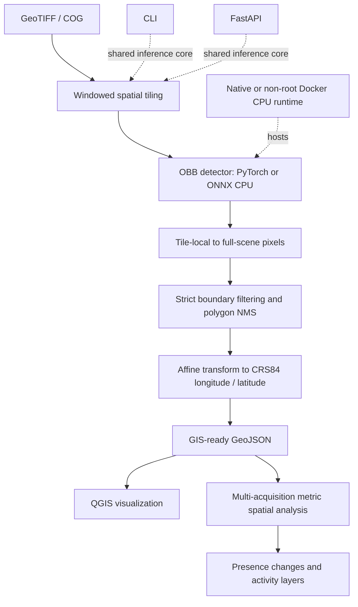

# Geo-Aware Aerial Object Detection

An end-to-end geospatial aerial-intelligence pipeline: large GeoTIFF/COG scenes
become oriented aircraft polygons, GIS-ready outputs, and multi-temporal spatial
activity layers through a shared CLI/FastAPI inference core with CPU Docker
deployment. It extends a pretrained DOTA OBB baseline with geospatial engineering,
RarePlanes domain adaptation, rigorous internal validation, and ONNX parity.

The contribution is the surrounding geospatial, evaluation, temporal, and
deployment system, **not a new YOLO26 detector architecture**. The detector
starting point is credited to
[JustinVladut/YOLO26-DOTA-v2](https://github.com/JustinVladut/YOLO26-DOTA-v2).

The central problem is that aerial scenes are much larger than a detector's
input tensor. Predictions made independently on overlapping tiles must be
mapped back to the source image, reconciled across tile boundaries, and then
transformed into geographic coordinates without losing OBB orientation or
provenance.

This repository reports internal RarePlanes validation results. The official
RarePlanes TEST split has not been used. The results therefore do not claim
official benchmark performance or broad snow-domain generalization.

## Results at a glance

**RarePlanes frozen internal validation**: 17 scenes from 12 location-disjoint
TRAIN locations, fixed inference/matching settings; not official TEST results.

| Model | Micro precision | Micro recall | Micro F1 | Mean matched OBB IoU |
|---|---:|---:|---:|---:|
| Original DOTA OBB | 0.6812 | 0.6759 | 0.6785 | 0.5469 |
| RarePlanes-adapted | 0.9720 | 0.9866 | 0.9793 | 0.8367 |

Micro F1 improved by **0.3007**, computed from unrounded aggregate counts.
Mean IoU describes matched true positives,
not unmatched aircraft; validation was also used for training early stopping.

| Engineering evidence | Verified outcome |
|---|---|
| Temporal spatial presence, location 84 | 3 acquisitions over ~769 days; `149 -> 166 -> 188` detections; 219 correspondences: 169 persistent, 50 displaced |
| Native/container deployment parity | 132 final detections in both; maximum coordinate difference `2.061e-10` degrees and confidence difference `4.173e-7` |
| ONNX CPU parity | 23/23 full-scene final polygons matched on one bounded validation scene |

Temporal correspondence is **not physical aircraft identity tracking**.
Full protocols and numerical limits are in [the methodology](docs/METHODOLOGY.md).

## What this project adds

| Scope | Contents |
|---|---|
| Detector starting point | Pretrained 18-class DOTA OBB model, its identity and historical training/result evidence |
| Geospatial engineering | COG windowing, OBB pixel/world transforms, strict boundary handling, cross-tile polygon NMS, and GeoJSON/QGIS output |
| Domain adaptation and validation | RarePlanes preparation and diagnosis, one-class fine-tuning, location-disjoint validation, full-scene evaluation, and reproducible provenance |
| Temporal spatial analysis | Metric-CRS correspondence and change/activity layers across acquisitions, without claiming aircraft identity |
| Deployment work | ONNX parity, shared CLI/FastAPI core, non-root CPU Docker, external model mounts, and asset-free CI validation |

Historical DOTA utilities and result assets remain for provenance, but they
are not the current RarePlanes geospatial workflow.

## Pipeline



Key behavior:

- Tiles are 1024 x 1024 with 20% overlap and integer stride 819. The stride is
  computed by positive round-half-up, and the final windows are anchored to
  the right and bottom scene boundaries so no source pixels are uncovered.
- Raster data is read one window at a time. Full scenes and hundreds of
  materialized inference tiles are not held in memory.
- A detection is accepted only when all four OBB vertices are inside the real
  source region of its tile. Padded pixels never become source coordinates.
- Duplicate detections are resolved in full-scene pixel space with
  class-aware greedy NMS using true Shapely polygon IoU, not axis-aligned IoU.
- Continuous model vertices are transformed directly by the raster affine;
  no integer-pixel-center offset is added. Reprojection uses `always_xy=True`,
  and exported coordinate order is always longitude, latitude.

See [docs/METHODOLOGY.md](docs/METHODOLOGY.md) for the split, geometry,
evaluation, fine-tuning, and deployment protocols.

## RarePlanes data and isolation policy

Only official RarePlanes real TRAIN imagery and annotations were used for
development, diagnosis, fine-tuning, and the internal validation reported
here. The official TEST split remains held out.

The TRAIN locations were divided before fine-tuning using a deterministic,
metadata-only, location-disjoint split:

| Internal subset | Locations | Scenes | Source aircraft | Generated tiles | Positive | Background |
|---|---:|---:|---:|---:|---:|---:|
| Train | 80 | 170 | 9,632 | 2,751 | 2,201 | 550 |
| Validation | 12 | 17 | 1,268 | 348 | 279 | 69 |

The frozen validation location IDs are `7, 10, 23, 25, 27, 31, 36, 42, 79,
84, 101, 108`. Train/validation scene overlap and location overlap are both
zero. The validation locations were selected from previously unanalysed TRAIN
locations without using model performance.

RarePlanes' official four-point aircraft diamond (nose, left wing, tail,
right wing) is preserved in provenance. Training and normalized OBB evaluation
derive a minimum-area rotated rectangle because the detector predicts
rectangular OBBs. Each object is assigned to exactly one eligible overlapping
tile only when its derived OBB is fully visible; labels are never silently
clipped. This represented 9,614/9,632 training objects and 1,265/1,268
validation objects.

## Domain diagnosis and adaptation

The original 18-class DOTA checkpoint recognized `plane`, but performed poorly
on parts of RarePlanes. A three-scene TRAIN-only diagnostic lowered confidence
to 0.05 and retained all DOTA classes. On the previously diagnosed snow scene
`96_10400100096C2500`, 385 of 399 aircraft had no overlapping response from
any class. That evidence points primarily to absent model response rather than
ordinary confidence filtering or class confusion. It is diagnostic evidence,
not an independent evaluation.

The aircraft-only model was initialized from `best.pt` and fine-tuned on the
natural RarePlanes TRAIN distribution with the frozen internal validation
split. The one-class head is `0: plane`. The completed run used Ultralytics
8.4.165, AdamW, image size 1024, batch size 8, seed 20261001, deterministic
mode, no frozen layers, and the recipe in
`configs/rareplanes_finetune_baseline.yaml`.

The Colab run was interrupted after epoch 10. A healthy `last.pt` preserving
optimizer state was resumed from epoch 11 after changing only the checkpoint's
patience argument to 20. Early stopping ended at epoch 79 and selected epoch 59.
Ultralytics reported chip-level validation precision 0.892, recall 0.976,
mAP50 0.959, and mAP50-95 0.815. These framework metrics are distinct from the
full-scene geospatial evaluation below.

## Frozen full-scene internal validation

Both checkpoints were evaluated on the same 17 internal validation scenes
with confidence 0.25, model IoU 0.45, global polygon-NMS IoU 0.50, and
one-to-one polygon matching at IoU 0.50. GT diamonds were converted to
minimum-area rectangles for the official OBB metrics; original-diamond
comparisons remain diagnostic only.

The 1,268 GT aircraft yielded `857 TP / 401 FP / 411 FN` for the original
checkpoint and `1,251 TP / 36 FP / 17 FN` after adaptation. The compact
comparison is [above](#results-at-a-glance); full counts and scene-macro metrics
are in [Methodology Section 9](docs/METHODOLOGY.md#9-frozen-full-scene-evaluation).

The validation set contains only one snow scene and 17 snow-scene aircraft;
the fine-tuned model detected 17/17 there. That is descriptive and is not
evidence of broad snow generalization. Independent official TEST performance
is unknown.

## ONNX deployment validation

The one-class checkpoint was exported as a fixed-batch, fixed-spatial ONNX
model (`1 x 3 x 1024 x 1024`, opset 18, no quantization, raw OBB output) and
run with ONNX Runtime CPU through the same geospatial pipeline.

Backend parity is a numerical deployment check, not an accuracy result:

| Check | PyTorch | ONNX Runtime | Agreement |
|---|---:|---:|---|
| One validation chip | 77 detections | 77 detections | 77/77 matched; mean polygon IoU 0.999999134; mean confidence delta 1.413e-7 |
| One 16-tile validation scene | 23 final detections | 23 final detections | 23/23 matched; mean polygon IoU 0.999997751; minimum 0.999969981 |

For the full scene `7_104001002D43CF00` (2994 x 3153), both backends produced
25 raw detections, one boundary rejection, 24 pre-NMS candidates, one NMS
suppression, and 23 final detections. PyTorch took 20.255 s and ONNX Runtime
took 16.071 s on the tested local CPU, approximately 1.26x faster for this one
bounded run. This is not a broad performance benchmark. The mean/max
confidence deltas were 3.162e-7 / 1.848e-6 and mean/max center differences
were 0.0000122 / 0.0001122 pixels.

TensorRT was not tested because the development laptop has no dedicated GPU.

## Environment

Python 3.12 is used. The known-good integrated environment was:

| Package | Tested version |
|---|---|
| Ultralytics | 8.4.165 |
| PyTorch / torchvision | 2.14.0+cpu / 0.29.0+cpu |
| NumPy | 2.5.3 |
| Rasterio / GDAL | 1.5.1 / 3.13.3 |
| PyProj / Shapely | 3.8.0 / 2.1.2 |
| OpenCV | 5.0.0.93 |
| ONNX / ONNX Runtime | 1.23.1 / 1.30.0 |

On Windows, a conda-forge/Miniforge environment is recommended for Rasterio,
GDAL, PyProj, and Shapely. Avoid installing standalone `gdal` from pip.
`environment.yml` is the concise, exact known-tested Windows CPU environment;
it keeps the native GIS stack under conda-forge and pins the validated
ML/ONNX packages. The broader `requirements.txt` remains the general-purpose
dependency declaration for other supported environments.

## Fresh-clone workflow

Run all commands from the repository root.

### 1. Clone and create the tested environment

```powershell
git clone https://github.com/Debjyoti-G77/geo-aware-aerial-obb.git
cd geo-aware-aerial-obb
conda env create -f environment.yml
conda run -n geo-aerial python -m pip check
```

The tested environment is CPU-only. A fresh full fine-tuning run requires a
CUDA-capable system and a compatible CUDA PyTorch build; it should preserve
the experiment settings in `configs/rareplanes_finetune_baseline.yaml`.

### 2. Supply external data and checkpoints

RarePlanes data is not redistributed. The authoritative acquisition reference
is the [RarePlanes page in the Registry of Open Data on AWS](https://registry.opendata.aws/rareplanes/),
which identifies the public bucket `s3://rareplanes-public/` and the dataset
license as CC BY-SA 4.0. The bucket can be inspected anonymously without an AWS
account:

```powershell
aws s3 ls --no-sign-request s3://rareplanes-public/
```

Inspect the official bucket and obtain only the real TRAIN PS-RGB COG imagery,
aircraft GeoJSON, and public metadata needed below. No unverified sync subpath
or official TEST download command is provided. Arrange the files as:

```text
datasets/RarePlanes/
  train/
    imagery/PS-RGB_cog/*.tif
    annotations/geojson_aircraft/*.geojson
  metadata/RarePlanes_Public_Metadata.csv
```

The preparation code accepts only this TRAIN layout; official RarePlanes TEST
is not part of the workflow.

Place model files at the repository root, or pass another repository-relative
path with `--model`. Checkpoints, datasets, generated outputs, and training
runs are intentionally Git-ignored.

```text
best.pt                         # original 18-class DOTA OBB checkpoint
rareplanes_finetuned_best.pt   # completed one-class project checkpoint
```

These files are not included in Git, and no project-hosted checkpoint download
is currently provided. Obtain trusted checkpoints separately under their
applicable terms, and verify their identity before use:

```powershell
Get-FileHash best.pt -Algorithm SHA256
Get-FileHash rareplanes_finetuned_best.pt -Algorithm SHA256
```

Expected hashes are listed under [Reproducibility hashes](#reproducibility-hashes).

### Minimal inference quickstart (no training preparation required)

After environment setup, supply a trusted compatible OBB checkpoint and a
three-band uint8 georeferenced raster. You do **not** need to generate a training
dataset to run inference:

```powershell
conda run -n geo-aerial python src/geospatial_inference.py `
  --model path/to/model.pt --input path/to/scene.tif `
  --output outputs/quickstart --target-class plane --device cpu
```

Load `outputs/quickstart/predictions.geojson` in QGIS. Alternatively use the
[FastAPI service](#fastapi-service) or [container deployment](#container-deployment)
below. The fine-tuned checkpoint is **not currently distributed by this source
repository**; hashes establish identity but are not download links. Readiness
without a model is deliberately HTTP 503, not a broken installation. Only load
checkpoints from trusted sources: a matching hash does not establish safety.

### 3. Prepare the RarePlanes YOLO OBB dataset

Review the deterministic plan first, then materialize the ignored generated
dataset. Both commands use RarePlanes TRAIN only.

```powershell
conda run -n geo-aerial python src/prepare_rareplanes_obb.py --plan-only
conda run -n geo-aerial python src/prepare_rareplanes_obb.py
```

The generated dataset is written to `datasets/RarePlanes_yolo_obb/`, with
manifests under its `manifests/` directory and audit output under `outputs/`.
The frozen 23 analysed-location exclusions are stored in the preparation code,
so ignored historical diagnostic manifests are not required in a fresh clone.

### 4. Validate readiness or start a fresh fine-tuning run

The default command validates configuration and writes provenance without
training. Transfer inspection and a bounded CPU smoke check are also explicit:

```powershell
conda run -n geo-aerial python src/train_rareplanes_obb.py
conda run -n geo-aerial python src/train_rareplanes_obb.py --inspect-transfer
conda run -n geo-aerial python src/train_rareplanes_obb.py --smoke-cpu
```

On a CUDA-capable training system, a new run is launched explicitly with:

```powershell
conda run -n geo-aerial python src/train_rareplanes_obb.py --train
```

This is a fresh run from `best.pt`; it does not automatically resume the
historical Colab run.

## Inference, export, and evaluation commands

Replace the example scene path with an available georeferenced TRAIN or
user-provided raster. Do not use official RarePlanes TEST for development or
tuning.

### Original DOTA PyTorch inference

```powershell
conda run -n geo-aerial python src/geospatial_inference.py `
  --input datasets/RarePlanes/train/imagery/PS-RGB_cog/2_104001003B4B5900.tif `
  --output outputs/geospatial_inference/dota_example `
  --model best.pt --target-class plane --device cpu
```

### Fine-tuned PyTorch inference

```powershell
conda run -n geo-aerial python src/geospatial_inference.py `
  --input datasets/RarePlanes/train/imagery/PS-RGB_cog/2_104001003B4B5900.tif `
  --output outputs/geospatial_inference/rareplanes_example `
  --model rareplanes_finetuned_best.pt --target-class plane --device cpu
```

Both commands inherit the frozen defaults in `configs/project.yaml`: image and
tile size 1024, overlap 0.20, confidence 0.25, model IoU 0.45, and global
polygon-NMS IoU 0.50.

### Export the fine-tuned checkpoint to ONNX

```powershell
conda run -n geo-aerial python src/export_rareplanes_onnx.py `
  --model rareplanes_finetuned_best.pt `
  --expected-sha256 4111cdab67bcc3c53623e4bd08aeb5943e4a49225c27c62172036b815991eced `
  --output-dir outputs/deployment/rareplanes_onnx
```

The exporter refuses incompatible OBB/class metadata and records export
provenance. Use `--parity-image <path-to-one-chip.png>` for the optional
bounded PyTorch-versus-ONNX parity check.

### ONNX geospatial inference

```powershell
conda run -n geo-aerial python src/geospatial_inference.py `
  --input datasets/RarePlanes/train/imagery/PS-RGB_cog/2_104001003B4B5900.tif `
  --output outputs/geospatial_inference/onnx_example `
  --model outputs/deployment/rareplanes_onnx/rareplanes_finetuned_best.onnx `
  --target-class plane --device cpu
```

The ONNX backend uses the same windowing, boundary validation, global polygon
NMS, coordinate conversion, and GeoJSON export code as PyTorch.

### Evaluate one frozen internal validation scene

Run inference first, then compare its final polygons with the corresponding
TRAIN annotation. The preparation manifest identifies the frozen internal
validation scenes; official RarePlanes TEST is not used.

```powershell
conda run -n geo-aerial python src/geospatial_inference.py `
  --input datasets/RarePlanes/train/imagery/PS-RGB_cog/7_104001002D43CF00.tif `
  --output outputs/geospatial_inference/rareplanes_val_7 `
  --model rareplanes_finetuned_best.pt --target-class plane --device cpu

conda run -n geo-aerial python src/geospatial_evaluation.py `
  --predictions outputs/geospatial_inference/rareplanes_val_7/predictions.geojson `
  --ground-truth datasets/RarePlanes/train/annotations/geojson_aircraft/7_104001002D43CF00.geojson `
  --raster datasets/RarePlanes/train/imagery/PS-RGB_cog/7_104001002D43CF00.tif `
  --output-dir outputs/geospatial_evaluation/rareplanes_val_7
```

The published aggregate numbers used the same command semantics across all 17
frozen location-disjoint validation scenes and the fixed settings documented
in `docs/METHODOLOGY.md`.

## GeoJSON and QGIS

Each scene output contains:

- `predictions.geojson`: final aircraft polygons;
- `inference_summary.json`: settings, counts, timing, and model metadata;
- `duplicate_suppressions.json`: cross-tile NMS provenance;
- `rejected_candidates.json`: invalid/boundary candidate diagnostics.

`predictions.geojson` is RFC 7946-style GeoJSON without a legacy `crs` member.
Coordinates are OGC:CRS84 longitude/latitude. Properties include detection and
scene IDs, class, confidence, source tile and offsets, tile bounds, local and
global pixel vertices, source/output CRS, model metadata, and inference/NMS
settings.

In QGIS, use **Layer > Add Layer > Add Vector Layer** to load
`predictions.geojson`, and add the source COG as a raster layer. Users can
inspect polygon orientation, confidence, scene/tile provenance, edge behavior,
and duplicate suppression in geographic context.

## FastAPI service

`src/api_service.py` exposes the same validated full-scene pipeline as a local
HTTP service; it does not implement a separate inference path. The checkpoint
stays outside Git and is configured at runtime. For example, in PowerShell:

```powershell
$env:GEO_OBB_MODEL_PATH = (Resolve-Path "path/to/rareplanes_finetuned_best.pt").Path
$env:GEO_OBB_MODEL_SHA256 = "4111cdab67bcc3c53623e4bd08aeb5943e4a49225c27c62172036b815991eced"
$env:GEO_OBB_BACKEND = "pt"
$env:GEO_OBB_DEVICE = "cpu"
conda run -n geo-aerial python -m uvicorn src.api_service:app --host 127.0.0.1 --port 8000
```

On POSIX shells, export the same four variables before running the `uvicorn`
command. The endpoints are:

- `GET /health/live`: process liveness without loading the model;
- `GET /health/ready`: checkpoint hash, OBB metadata, and target-class readiness;
- `GET /model`: non-sensitive deployment metadata and frozen inference settings;
- `POST /infer`: multipart `file` upload of a georeferenced RGB uint8 GeoTIFF/COG.

```bash
curl -X POST http://127.0.0.1:8000/infer \
  -F "file=@scene.tif;type=image/tiff" \
  -o inference-response.json
```

The response contains raster metadata, inference counts/timing, and an RFC
7946-style CRS84 GeoJSON FeatureCollection ready for GIS use. Uploads are
streamed with a configurable 512 MiB default limit
(`GEO_OBB_MAX_UPLOAD_BYTES`), stored under a server-controlled temporary name,
and removed after the request. Inference is serialized while one lazily loaded
model is reused. This is a local/portfolio deployment boundary, not a hardened
public service: internet exposure would additionally require authentication,
authorization, TLS, rate limiting, request isolation, observability, and
resource/process supervision. Temporal analysis remains a separate offline
workflow, not an API endpoint.

## Container deployment

The CPU image keeps the Linux GIS stack together under conda-forge and uses
explicit CPU PyTorch wheels. Models and datasets are excluded from the build.
Build from the repository root, then configure an existing external checkpoint:

```powershell
docker build --tag geo-aware-aerial-obb:local .
$env:MODEL_FILE = (Resolve-Path "path/to/rareplanes_finetuned_best.pt").Path
$env:GEO_OBB_MODEL_SHA256 = "4111cdab67bcc3c53623e4bd08aeb5943e4a49225c27c62172036b815991eced"
docker compose up --detach
```

On POSIX shells, use `export MODEL_FILE=/absolute/path/to/model.pt` and export
the digest before the same Compose command. Compose mounts that one file
**read-only** at `/models/rareplanes_finetuned_best.pt` and supplies
`GEO_OBB_MODEL_PATH`, `GEO_OBB_MODEL_SHA256`, `GEO_OBB_BACKEND=auto`, and
`GEO_OBB_DEVICE=cpu`. Model binaries intentionally remain external.

The service runs as a non-root user, binds to `0.0.0.0` inside the container,
and is published only on host loopback by default:

```bash
curl http://127.0.0.1:8000/health/live
curl http://127.0.0.1:8000/health/ready
curl http://127.0.0.1:8000/model
curl -X POST http://127.0.0.1:8000/infer \
  -F "file=@scene.tif;type=image/tiff" -o inference-response.json
docker compose down
```

In Windows PowerShell, use `curl.exe` for these examples. `HOST_PORT` controls
the published port and `PORT` the internal port (both default to 8000).
`GEO_OBB_MAX_UPLOAD_BYTES` controls the application upload limit. For ONNX,
set `MODEL_FILENAME` to an `.onnx` filename and supply that artifact's digest.
Docker's healthcheck uses `/health/live`; missing models leave liveness healthy
and readiness at HTTP 503. `.github/workflows/ci.yml` builds the same dependency
image, checks imports, runs focused/full tests, builds the runtime image, and
checks no-model health behavior without model inference, datasets, or GPU.
The workflow is locally validated; hosted Actions execution is pending publication.
The local-service deployment limitations above still apply.

## Multi-temporal aircraft activity analysis

`src/temporal_aircraft_analysis.py` compares predictions from two or more
timestamped images of the same location. It automatically uses a local metric
CRS for polygon overlap and centroid-distance calculations, creates
deterministic one-to-one spatial correspondences between consecutive
acquisitions, and classifies detected presence as persistent, displaced,
appeared, or disappeared. With three or more timestamps it also produces a
simple metric-grid activity aggregation.

The default frozen-VAL workflow selects a repeated TRAIN location using only
metadata and raster georeferencing: maximum acquisition count, then maximum
temporal span, then lowest location ID. Compatible existing fixed-policy
inference outputs are reused; only missing selected scenes are inferred. A
portable explicit manifest can also be supplied:

```powershell
conda run -n geo-aerial python src/temporal_aircraft_analysis.py `
  --manifest path/to/temporal_manifest.csv `
  --output outputs/temporal_analysis
```

The manifest columns are `location_id`, `scene_id`, `acquisition_time`,
`predictions_path`, and optional `raster_path`. Outputs include temporal
detection polygons, correspondence lines, appeared/disappeared polygons,
JSON/CSV summaries, and—when at least three timestamps exist—an activity-grid
GeoJSON. All geographic outputs use RFC 7946 longitude/latitude semantics and
can be loaded directly into QGIS.

**This workflow measures changes in detected spatial aircraft presence; it
does not establish physical aircraft identity across acquisitions.** The
correspondence distance and persistent-position boundary are documented
analysis parameters, not detector thresholds and not ground-truth-tuned
tracking parameters.

The location-84 demonstration in the results table used three acquisitions
from 2017-01-30 to 2019-03-10. Its 130-cell activity grid and all temporal layers
passed geometry and CRS84 validation. Per-pair details and correspondence
parameters are in [Methodology Section 12](docs/METHODOLOGY.md#12-multi-temporal-aircraft-activity-analysis).

## Reproducibility hashes

| Artifact | SHA-256 |
|---|---|
| Original DOTA `best.pt` | `5102e1493e3d1f2d0bb331d246e060badb1709f405cd17cd4a558cac9faefbef` |
| Fine-tuned `rareplanes_finetuned_best.pt` | `4111cdab67bcc3c53623e4bd08aeb5943e4a49225c27c62172036b815991eced` |
| Exported `rareplanes_finetuned_best.onnx` | `09ae20574cddb0f69b36bbdbb0c11eaec8d12ed640b3515f65c8f6e726d6331b` |

## Repository map

```text
configs/                         portable runtime, dataset, and training recipes
environment.yml                 exact known-tested Windows CPU environment
src/geospatial_tiling.py         deterministic windows and coordinate transforms
src/geospatial_inference.py      PyTorch/ONNX full-scene inference and GeoJSON
src/api_service.py               local FastAPI wrapper around geospatial inference
src/geospatial_evaluation.py     polygon-IoU evaluation
src/temporal_aircraft_analysis.py same-location temporal activity analysis
src/prepare_rareplanes_obb.py    TRAIN-only OBB dataset preparation
src/low_confidence_probe.py      pre-adaptation response diagnostic
src/train_rareplanes_obb.py      explicit training/readiness launcher
src/export_rareplanes_onnx.py    fixed-shape ONNX export and parity validation
Dockerfile / compose.yaml        CPU service build and external-model startup
deploy/                          Linux reference pins, launcher, liveness probe
.github/workflows/ci.yml          asset-free unit and container validation
tests/                           deterministic unit and integration tests
docs/METHODOLOGY.md              detailed experimental protocol and limitations
```

### Historical DOTA baseline material

`src/train.py` and `src/resume.py` preserve the DOTA recipe as import-safe,
explicit baseline utilities. They are not used by the RarePlanes
workflow. `src/benchmark_edge.py`, `src/analyze_edge_results.py`,
`src/analyze_results.py`, `results/`, `examples/`, and the older visual assets
are retained DOTA baseline evidence. Their desktop proxy edge study
must not be confused with this project's validated RarePlanes ONNX Runtime CPU
parity check.

The historical chart/benchmark scripts are working-directory-dependent and
execute at import; they are retained evidence, not supported service entry
points. Desktop execution-provider proxies do not establish Jetson/Raspberry
Pi performance or device-specific latency bounds.

## Credits, license, and attribution

The detector baseline provided the starting point for this project's
geospatial and domain-adaptation work and is credited to
[JustinVladut/YOLO26-DOTA-v2](https://github.com/JustinVladut/YOLO26-DOTA-v2).
Its original copyright and unmodified MIT notice are preserved in
[LICENSES/YOLO26-DOTA-v2-MIT.txt](LICENSES/YOLO26-DOTA-v2-MIT.txt).

This combined source project is released under
[AGPL-3.0](LICENSE). The geospatial, RarePlanes, evaluation, reproducibility,
and deployment extensions were contributed by Debjyoti Sengupta, 2026,
without claiming ownership of the detector baseline. Ultralytics remains a
separately licensed AGPL-3.0 dependency (or is subject to applicable commercial
terms obtained separately). RarePlanes imagery and annotations are external,
are not redistributed, and remain under CC BY-SA 4.0. Model and deployment
binaries are not bundled. See
[THIRD_PARTY_NOTICES.md](THIRD_PARTY_NOTICES.md) for the concise dependency,
dataset, and model-distribution notices.
